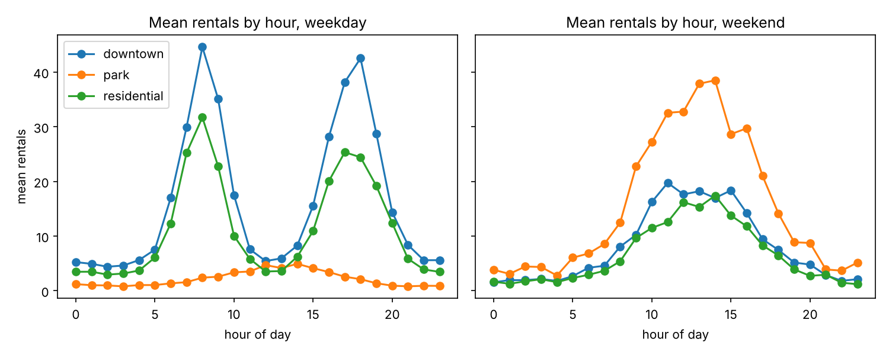
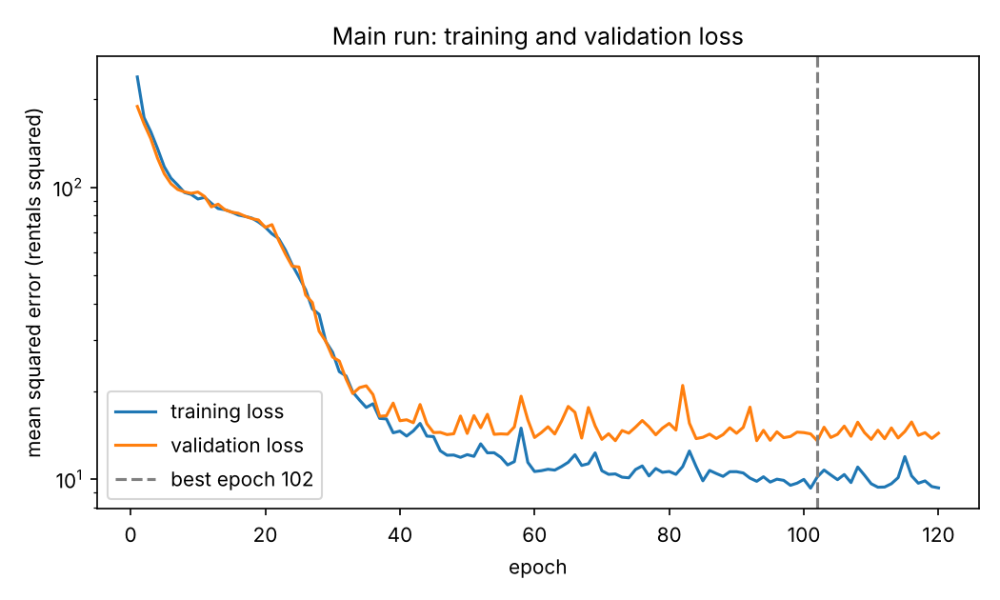

# Lakeshore Bike Demand

## What it does

This project predicts how many bikes will be rented from a Lakeshore Bike Share station in a given hour, using the hour of the day, the weather, whether it is a weekend and the type of station. The network and its training loop are written by hand in PyTorch, and the result is compared with two simple baselines so a planner can see whether the extra work is worth it. On the held-out test rows the network is off by about 2.3 bikes on average, against 8.8 for a linear regression and 9.8 for always guessing the mean.

## How to run it

```bash
conda env create -f environment.yml
conda activate lab07-first-principles

python train.py            # recreates everything in reports/ (about a minute on a CPU)

python -m ruff format --check .
python -m ruff check .
python -m pytest
```

`train.py` seeds everything, so two runs on the same computer give identical numbers. On another machine the last digits may differ.

## Data and split

`bikes_data.py` is the file we were given and I have not touched it. `make_rentals()` returns 6,000 invented station-hours, the same ones for everybody.

I split the table first, before any preparation: 60% training (3,600 rows), 20% validation (1,200) and 20% test (1,200), with a fixed seed (2026). Only after that do I fit anything. The `StandardScaler` for hour, temperature, rain, wind and the weekend flag is fitted on the training rows alone, and so is the one-hot encoder for the station type (which has a fixed list of three categories). The validation and test rows are then only transformed. If the scaler had seen them, a bit of their information would leak into the features and the validation score would look better than it should. `tests/test_prepare.py` checks this: the training features average zero and the validation features do not.

Before choosing any model I plotted the mean rentals by hour:



A straight line cannot describe this. On weekdays the downtown and residential stations have two humps, one around 08:00 and one around 17:30, and the park stations are nearly flat. On weekends it flips: the parks get the biggest hump, around midday. So the effect of the hour depends on the station type and on the weekend, and it goes up and down during the day. Temperature is not linear either (rentals peak near 21 °C and fall off on both sides), and rain cuts demand by a factor, not by a fixed amount.

## Model and training

- **Network** (`model.py`): `RentalNet`, an `nn.Module` with two hidden layers of 128 units, each followed by ReLU, and a final `Linear(128, 1)` with no activation, because the target is a count. `forward` returns shape `(N,)`, matching the targets, so the loss never silently broadcasts an `(N, 1)` against an `(N,)`.
- **Dataset** (`prepare.py`): `RentalsDataset` returns one row at a time as float32 tensors. Only the training loader shuffles.
- **Loss and optimizer**: mean squared error and Adam with a learning rate of 3e-3.
- **Batches and epochs**: batches of 128, 120 epochs.
- **Loop** (`train.py`): `run_epoch` trains when it is given an optimizer and only measures when it is not (no gradients, `model.eval()`). `fit` logs the training loss, the validation loss and the validation MAE for every epoch, and puts back the weights from the epoch with the lowest validation loss.
- **Seeds**: the split uses 2026. `train.py` seeds PyTorch and the training loader's generator with 42.

I picked the main configuration by looking at validation loss and validation MAE only. My first attempt (1e-3, 64 units, 60 epochs) was still improving at the last epoch, so I made the learning rate larger, the network a bit wider and trained for longer. The other things I tried (three layers, other batch sizes) all landed within about 0.1 of the same validation MAE, so I kept the simplest one.

## Results

Every number is in rentals (bikes per station-hour). The test rows were used once, for the final network only.

| Model | Validation MAE | Validation RMSE | Test MAE | Test RMSE |
|---|---|---|---|---|
| Training mean | 9.95 | 14.18 | 9.85 | 13.79 |
| Linear regression | 9.03 | 13.15 | 8.76 | 12.64 |
| Network (best epoch 102) | 2.46 | 3.68 | 2.34 | 3.49 |

The linear model barely beats the mean, and the reason is in the plot above. It can only add a fixed amount per hour, per degree and per station type. It cannot make a morning hump that exists on weekdays downtown but not in a park, and it cannot know that 08:00 matters a lot on a weekday and hardly at all on a Sunday. The network, with its hidden layers, can combine those features, and it cuts the error by about three quarters.



The curves (log scale on the vertical axis) show a healthy run. Both losses fall together for the first 30 epochs or so, with a plateau around epoch 10 to 20 before the network works out the hour-by-station pattern. After about epoch 40 the training loss keeps going down slowly (to about 9) while the validation loss stays around 14. The two are close, and the validation curve is noisier than the training curve, which is normal for 1,200 rows. The lowest validation loss is at epoch 102, and that is the weights I kept. The gap between training and validation is small but real, and the experiments below show what happens when it grows.

The error is not even across rows. On the validation rows with 30 or more rentals (122 of them) the MAE is about 6.2, against about 2.0 for the rest. The rush-hour peaks are where the model is least precise.

## Experiments

Each run changes one thing from the main run and keeps everything else, including the seeds. All of them were judged on the validation rows. The curves for each run are in `reports/curves/`, and the full table is in `reports/experiments.csv`.

| Run | What changed | Best epoch | Best val MAE | Final train loss | Final val loss |
|---|---|---|---|---|---|
| main | reference (128 units, lr 3e-3, 120 epochs) | 102 | 2.46 | 9.33 | 14.36 |
| lr_tiny | learning rate 1e-5 | 120 | 8.94 | 219.01 | 218.81 |
| lr_huge | learning rate 0.3 | 65 | 10.01 | 204.09 | 201.06 |
| small_net | 8 units per layer | 117 | 7.03 | 112.09 | 109.80 |
| wide_net | 1024 units per layer | 26 | 2.44 | 7.17 | 15.86 |
| long_run | 400 epochs | 102 | 2.46 | 7.26 | 15.83 |

**lr_tiny (underfitting, too slow).** The two curves lie on top of each other and fall in an almost straight line. After 120 epochs the loss is still 219 and it is still going down. Nothing is wrong with the network; the steps are just too small to get anywhere in the time given.

**lr_huge (unstable, then stuck).** The training loss in the first epoch is over 4,000, and then it drops and flattens at about 204 from epoch 10 on. A validation loss of about 201 is what you get from predicting the mean (14.18 squared is about 201), and the MAE of 10 matches the mean baseline too. The big first steps broke the network and it has stopped learning anything beyond the average. The curve is flat, which is why it looks calm, but it is a failed run.

**small_net (underfitting, not enough capacity).** Eight units per layer is too few to represent the hour, station and weather interactions. Training and validation loss are close together (112 and 110), both high, and both still creeping down at the end. When the two curves are this close and this high, the problem is the model, not the data.

**wide_net (overfitting, early).** With 1024 units the network learns very fast and reaches its best validation loss at epoch 26. After that the training loss keeps falling (to 7.2) while the validation loss climbs back up (to 15.9). The gap between the curves is the sign of overfitting. The best-epoch weights are about as good as the main run (MAE 2.44 against 2.46), so the extra size bought nothing, and that is the reason I did not choose it.

**long_run (overfitting, slowly).** Same network, 400 epochs. It follows the main run exactly until epoch 102, which is the best epoch again, and then the validation loss drifts up from about 13.5 to 15.8 while the training loss goes down to 7.3. Training longer only fits the noise in the training rows. Keeping the weights from the best epoch is what protects the final result here, and it is the reason `fit` restores them.

## Limitations

The data are invented. The table comes from a formula plus random noise, so everything above says how well a network can recover that formula and nothing about real Lakeshore riders. I would expect the real numbers to be worse.

What the model sees is only the hour, the weather in that same hour, the weekend flag and the station type. It does not know which station it is, so two downtown stations with very different surroundings get the same prediction. It does not know about holidays, events, school terms, the day before, or the last hour's rentals. It also uses the weather of the hour being predicted, so a planner who wants a forecast would have to feed it a weather forecast, and the error would then be larger than reported here.

The target is rentals, not demand. If a station runs out of bikes, rentals stop even though people still want one. The model cannot tell those cases apart.

The output is a single number with no sense of how sure it is. Rentals are counts with natural noise, so even a perfect model would miss by a few bikes in a given hour. The error is also larger at the peaks (about 6 on rows with 30 or more rentals), and a very small share of predictions (0.3% of validation rows) come out slightly below zero and should be rounded up to zero.

A planner should not use this to decide how many bikes to put at one particular station on one particular day, or for temperatures, rain or wind outside the range in the data (roughly −15 to 35 °C). It is reasonable as a rough guide to which kinds of stations will be busy at which hours.
